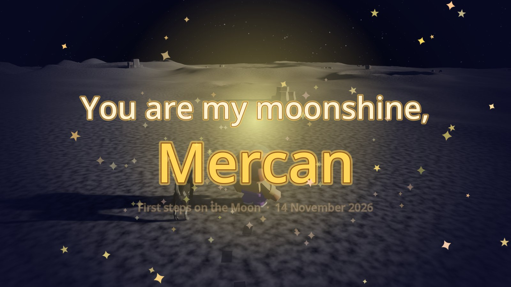
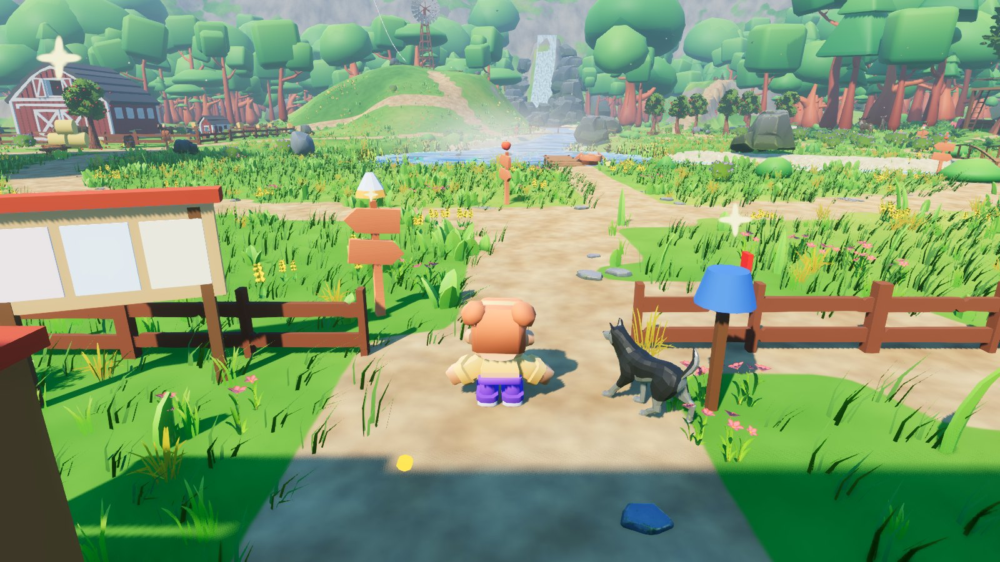
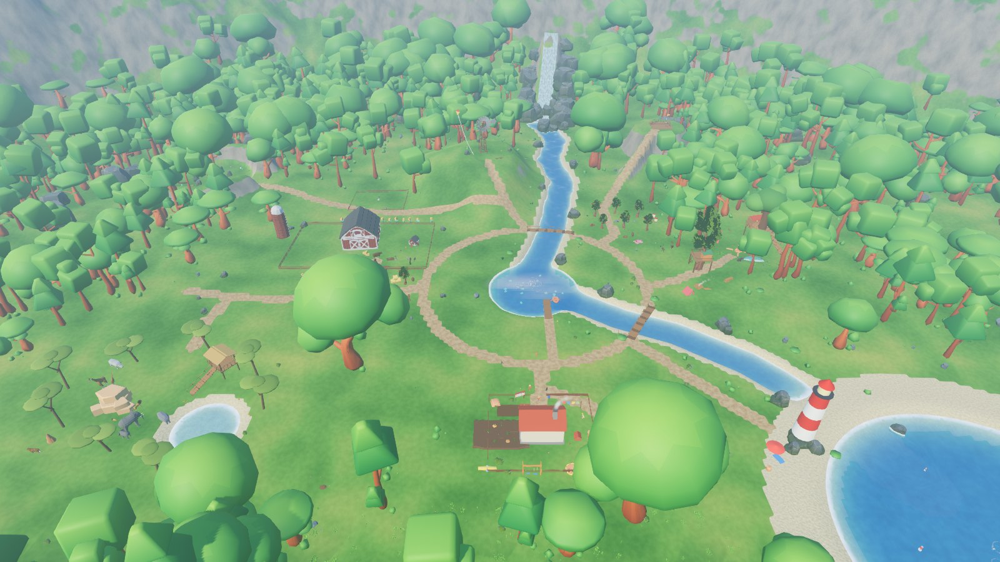
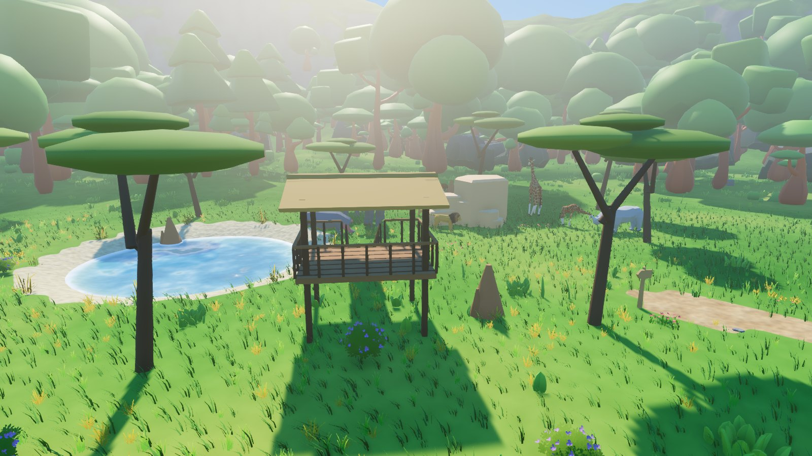
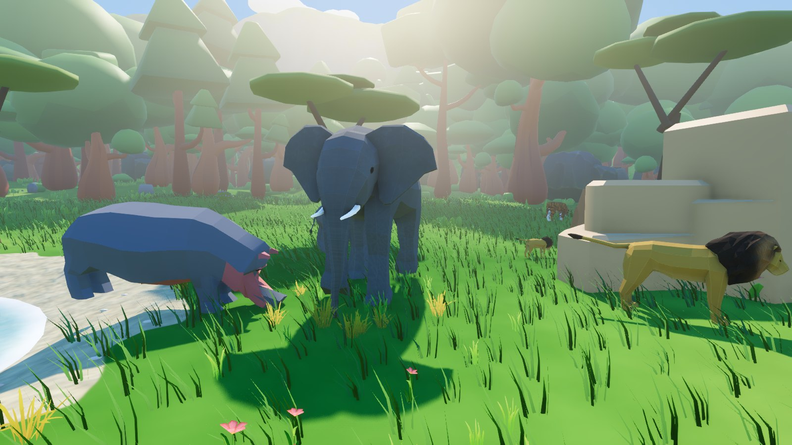
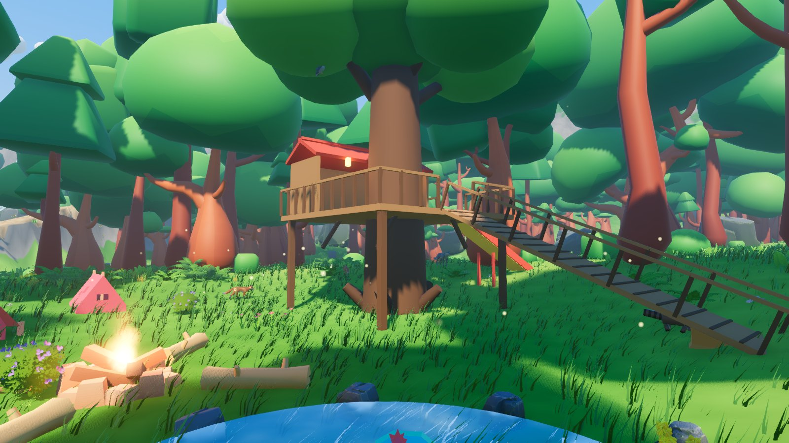
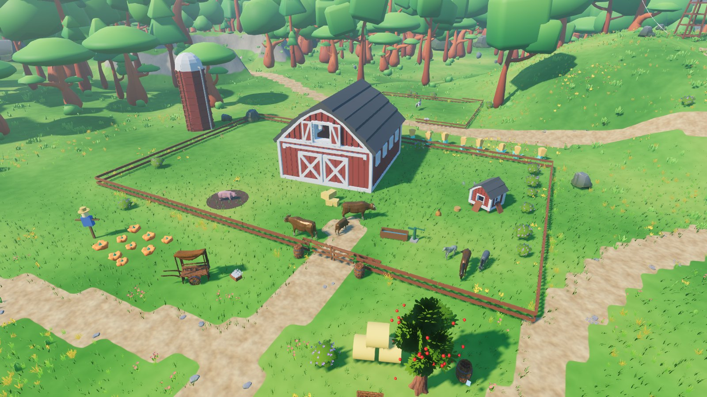
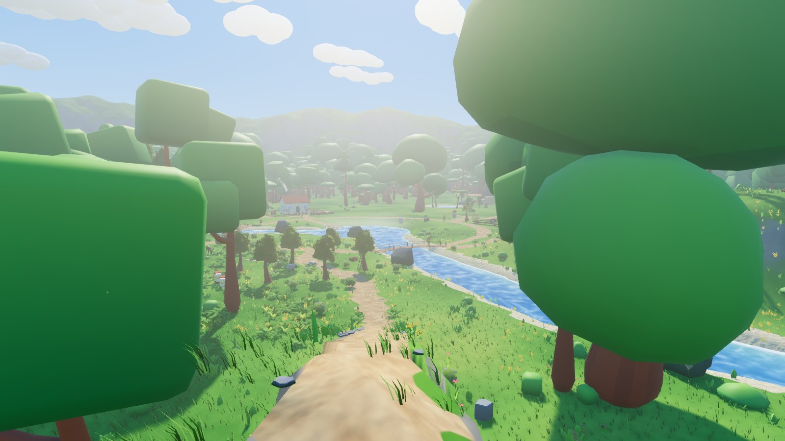
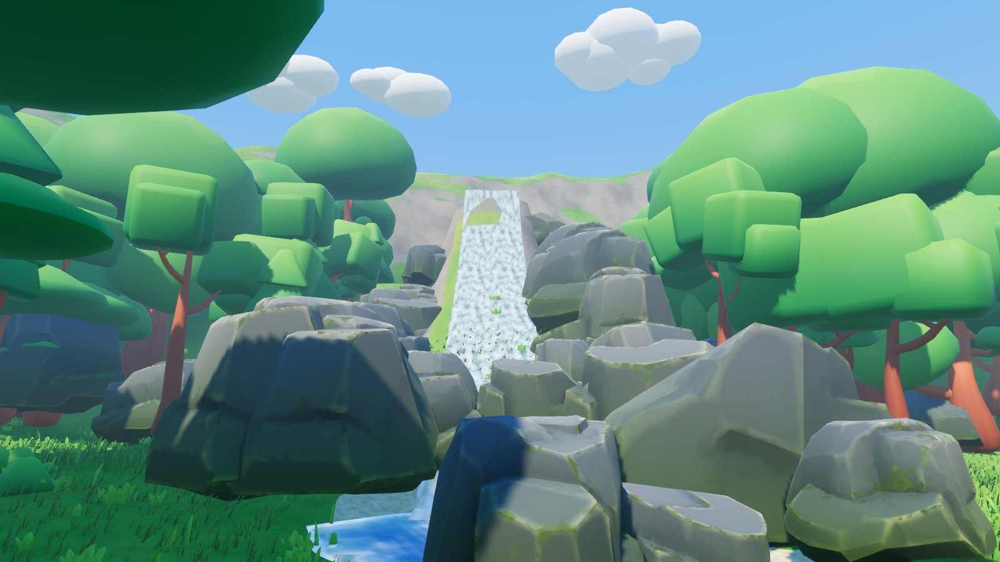

# Toddler Island 🌙

**A 3D world I made for my two-year-old daughter, Mercan.**

She can't read yet, and most games are too fast, too loud or too full of menus for a toddler. So I built
one around how she actually plays: she sits on my lap, I steer with an Xbox controller, and she presses
the big button whenever something lights up. Nothing can go wrong, nothing ever chases her, and every
press does something kind.

  

When she takes ten steps on the Moon, the words *"You are my moonshine, Mercan"* glow in letter by letter
over a little music-box tune, and a photo of the moment is saved for us to keep.

---

## What's in the valley

<table>
  <tr>
    <td></td>
    <td></td>
  </tr>
  <tr>
    <td align="center">Every adventure starts at the cottage, with her dog.</td>
    <td align="center">A green valley ringed by mountains, with a waterfall, river, pond and lake.</td>
  </tr>
  <tr>
    <td></td>
    <td></td>
  </tr>
  <tr>
    <td align="center">The safari plain: acacias, a waterhole and a hide on stilts.</td>
    <td align="center">Elephants, giraffes, lions, a hippo, a rhino and a tiger.</td>
  </tr>
  <tr>
    <td></td>
    <td></td>
  </tr>
  <tr>
    <td align="center">The treehouse camp: up the ramp, down the slide, warm up by the fire.</td>
    <td align="center">The farm: cows, horses, a donkey, a pig, hens, calves and foals.</td>
  </tr>
  <tr>
    <td></td>
    <td></td>
  </tr>
  <tr>
    <td align="center">The lookout: a ramp up a rocky outcrop and a sweep over the whole valley.</td>
    <td align="center">A waterfall pours out of the mountains and becomes the river.</td>
  </tr>
</table>

- **Around 35 animals she can stroke and feed.** They notice her, come when called, eat from her hand
  and follow her for a while. Rabbits hop into their burrows if she runs at them, squirrels spiral up the
  trees, ducklings paddle behind their mother, crabs dance when she says hello.
- **A trip to the Moon.** She and the dog climb into the rocket, count down, see the Earth shrink
  behind them, land, plant a flag and bounce around in low gravity.
- **Things to do everywhere:** a swing that really swings, slides, a merry-go-round, a boat to row, a
  kite to fly, fishing off the jetty, sandcastles, a telescope, a wishing stone in a fairy hollow.
- **A sticker book** that fills up as she meets each animal, and says its name.
- **Music she won't get tired of:** happy, cosy and adventure tracks, or music-box lullabies, picked
  by the parent with one button.
- **A parent menu** to set how long the day lasts (the sun sets when it's time to stop), adjust the
  volumes, and record your own voice to cheer her on.

## Made for a toddler

- **One button.** Whatever she can do is shown as a picture card at the bottom of the screen ("Feed the
  horse", "Slide down!"). Any key or button does it, so small hands can't press the wrong thing.
- **No failing, no timers, no scary bits.** Animals never flee from her in fear or threaten her; the
  shy ones just hide and peek out again.
- **No reading needed.** Everything is pictures, sounds and gentle spoken words.
- **The parent steers.** The camera, walking and the menus are on the controller; she does the fun part.
- **A natural end.** The sun sets after the time you choose, the animals walk home to the barn, and the
  day ends gently instead of with a tantrum.

## Play it

**Windows:** download **[ToddlerIsland-Windows.zip](https://github.com/mert-atalay/toddler-island/releases/latest/download/ToddlerIsland-Windows.zip)**
(237 MB), unzip it and double-click `ToddlerIsland.exe`. Nothing to install. Windows may warn that
the app isn't from a known publisher; click **More info** → **Run anyway**.

**From the source (any computer):** install [Godot 4.7](https://godotengine.org/download), download this
repository (green **Code** button → **Download ZIP**), then double-click **`Play Toddler Island.bat`**
or open `game/project.godot` in Godot and press Play. The first start takes a few minutes while Godot
imports the models.

An Xbox controller is the best way to play; a keyboard works too. All the controls are in the
[parent's handbook](docs/HANDBOOK.md).

To use your own child's name in the Moon message, change `child_name` in the save file
(`%APPDATA%\Godot\app_userdata\Toddler Island\save.json`).

## How it's built

- **[Godot 4.7](https://godotengine.org)** and GDScript, about 14,000 lines across 37 scripts, with
  custom shaders for the water, grass, sky, Earth and Moon.
- **[Terrain3D](https://github.com/TokisanGames/Terrain3D)** for the valley: one height function
  shapes the ground, the river bed, the lookout and the fairy hollow, and everything else (water,
  plants, animals, paths) agrees with it.
- **Animals that think a little:** hunger, thirst and tiredness decide whether each one grazes, drinks,
  rests in the shade or wanders with its herd, and they find routes around fences on a grid map.
- **An automatic rigger** ([`game/lib/autorig.gd`](game/lib/autorig.gd)): the lion, elephant, giraffe
  and the other safari animals came as still models. The game measures each one, finds its legs, head,
  tail (and the elephant's trunk), builds a skeleton and weights every vertex, then writes walk, gallop,
  graze, rest and happy animations, all in code.
- **Built-in tests:** a photo tour, a test that presses every single interactive thing (147 of them),
  a soak test that watches every animal for getting stuck, and a speed check (around 100 fps at
  1080p on a laptop RTX 3050).
- I built it together with [Claude Code](https://claude.com/claude-code), Anthropic's AI coding
  assistant: I designed the game and decided what Mercan needed, and we wrote and tested the code
  side by side.

## Credits

Built on wonderful free assets: models by **Quaternius**, **KayKit**, **Kenney**, **Tiny Treats**
(Isa Lousberg) and **Poly by Google**; music by **Kevin MacLeod** (incompetech.com); animal sounds
from **Wikimedia Commons**; Earth and Moon maps from **Solar System Scope**. Full list and licences in
[CREDITS.md](CREDITS.md).

The code is MIT-licensed ([LICENSE](LICENSE)). The assets keep their own licences, listed in the credits.

---

*Made with love for Mercan. 💛*
